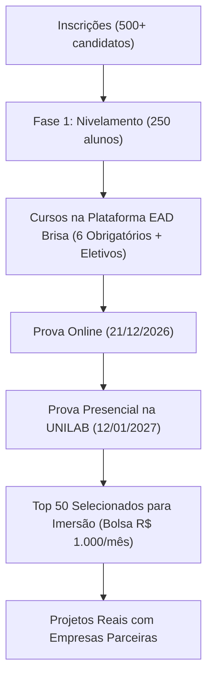

# Resumo Oficial da Aula Inaugural — Residência em TIC 16 (BRISA - UNILAB)

**Data da Aula:** 29 de Outubro de 2026  
**Duração da Gravação:** 1 hora, 48 minutos e 49 segundos  
**Local:** UNILAB — Campus das Auroras / Redenção - CE  
**Arquivos de Apoio:**
- [Transcrição Completa (.txt)](file:///Users/matheus/ti/redencao/01-curso-introdutorio/anotacoes/transcricao-aula-inaugural.txt)
- [Legendas com Timestamps (.srt)](file:///Users/matheus/ti/redencao/01-curso-introdutorio/anotacoes/transcricao-aula-inaugural.srt)

---

## 1. Panorama Geral e Números do Programa

- **Inscrições recebidas:** Mais de 500 candidatos inscritos.
- **Selecionados para a Etapa 1 (Nivelamento):** 250 estudantes.
- **Vagas para a Etapa 2 (Imersão em Computação Avançada e Projetos):** **50 residentes selecionados** (com reserva de pelo menos 20 vagas para mulheres / ações afirmativas).
- **Bolsa de Estudos na Etapa de Imersão:** **R$ 1.000,00 / mês** por residente durante o desenvolvimento do projeto prático com empresas parceiras.

---

## 2. Estrutura das Fases e Dinâmica de Seleção

### 2.1. Fase 1: Nivelamento (Etapa Atual)
- **Plataforma EAD:** Realização dos cursos obrigatórios e eletivos na plataforma de ensino a distância da Brisa.
- **Composição da Nota de Classificação:**
  1. **Nota da Prova Online** (aplicada ao final do nivelamento).
  2. **Nota da Prova Presencial** (aplicada na UNILAB).
  3. **Cursos Concluídos na Plataforma:** A conclusão das disciplinas eletivas soma **pontos extras decisivos (+2,5 pontos por eletiva)** para desempate e classificação no topo.
  4. **Cadastro de Reserva:** Candidatos logo abaixo do corte de 50 devem ficar atentos à lista de espera, pois sempre ocorrem desistências ou remanejamentos antes do início dos projetos.

---

## 3. Fase 2: Imersão em Computação Avançada (Projetos Práticos)

Para os 50 alunos classificados:
1. **Semana de Integração:**
   - 4 horas diárias presenciais na primeira semana para formação dos times, definição de temas e imersão no escopo.
2. **Projetos Reais com Clientes Locais:**
   - Cada grupo trabalhará em um desafio real trazido por empresas ou instituições parceiras da região.
   - Entregas de Engenharia de Requisitos, UI/UX (telas validadas pelo cliente) e desenvolvimento de software funcional.
3. **Banca de Avaliação no 2º Mês:**
   - Apresentação formal de protótipos e arquitetura para banca de avaliadores.
4. **Composição da Avaliação durante o Projeto:**
   - **Nota da Banca:** Avaliação técnica do resultado do projeto entregue pelo grupo.
   - **Nota do Orientador:** Avaliação do professor/orientador sobre o engajamento individual e técnico do residente.
   - **Avaliação 360º (Pares):** Avaliação entre os próprios colegas de equipe sobre colaboração, pontualidade e trabalho em equipe.
   - **Frequência Obrigatória:** Presença exigida na reunião semanal presencial com a coordenação e equipe.

---

## 4. Pontos de Atenção e Estratégia de Aprovação (Matheus)

> [!IMPORTANT]
> **Como garantir a vaga entre os 50 primeiros:**
> 1. **Completar os 6 Cursos Obrigatórios com 100% de aproveitamento:** Fundamentais para a base das duas provas.
> 2. **Concluir o maior número de Cursos Eletivos (+2,5 pts cada):** Foco prioritário em *UI/UX*, *Engenharia de Requisitos*, *Mobile* e *Fundamentos de IA*. Cada eletiva concluída garante pontuação adicional que separa os aprovados da lista de espera.
> 3. **Treinamento focado no formato das Provas:** Resolver simulados com limite de tempo e questões de múltipla escolha idênticas às aplicadas pela coordenação.
