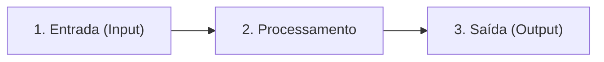

# Anotações — Lógica de Programação com Python (Parte 1: Tópicos 1.1 a 1.5)

- **Data de Estudo:** 24/10/2026 e 25/10/2026
- **Escopo:** Vídeo introdutório do módulo + Apostila (Páginas 1 a 26 — Tópicos 1.1 até o início do 1.5.1).

---

## 1. Visão Geral (Vídeo + Tópico 1.1: Introdução e História)

### Conceitos Fundamentais do Vídeo
- **Lógica de Programação:** Base para estruturar o raciocínio e resolver problemas utilizando o computador.
- **Algoritmo:** Sequência finita e lógica de instruções passo a passo para atingir um objetivo ou resolver um problema.
- **Boas Práticas Iniciais de Construção de Soluções:**
  - **Decomposição:** Quebrar um problema grande em passos menores e mais simples.
  - **Comentários e Documentação:** No início do aprendizado, comentar o código (`# comentário`) ajuda a registrar o que cada linha faz. Com a prática e experiência, busca-se escrever um **código limpo e autodescritivo** (*Clean Code*), acompanhado de documentação técnica de apoio.

### 1.1.1 Linha do Tempo e Personagens Históricos
| Período / Personagem | Contribuição Histórica |
| :--- | :--- |
| **Década de 1800 — Ada Lovelace** | Produziu notas sobre a programação da *"Máquina Analítica"* (projetada pelo inventor britânico **Charles Babbage**). É considerada a **primeira programadora da história**. |
| **1930 — Alan Turing** | Matemático e criptógrafo inglês; propôs a **"Máquina de Turing"** (base teórica para o conceito moderno de algoritmo e computação) e atuou na quebra do código da máquina nazista **Enigma** na 2ª Guerra Mundial. |
| **Década de 1940 — Konrad Zuse** | Construiu a máquina **Z3**, considerada o **primeiro computador programável eletromecânico**. |
| **Década de 1950 — John Tukey** | Cunhou o termo **"Software"**. Nessa década surgiram as primeiras linguagens de programação de alto nível, como **Fortran** e **COBOL**. |
| **1970 — Dennis Ritchie** | Desenvolveu no *Bell Labs* a linguagem de programação **C**. |
| **Década de 1980** | Revolução dos computadores pessoais (PCs), popularizando linguagens como **BASIC**, **Pascal** e **C++**. |
| **Década de 1990 — Tim Berners-Lee** | Criou a **WWW (*World Wide Web*)**, impulsionando a programação voltada para a web. *(Atenção: não confundir WWW com a própria Internet física).* |
| **Década de 2000 em diante** | Expansão e popularização de linguagens de alto nível mais acessíveis, como **Python**, **Ruby** e **JavaScript**. |

- **Indicações Culturais (Filmes citados na apostila):**
  - *Conceiving Ada* (*Conceber Ada*, 1997) — sobre Ada Lovelace.
  - *The Imitation Game* (*O Jogo da Imitação*, 2014) — sobre Alan Turing e a máquina Enigma.

---

## 2. Algoritmos, Fluxogramas e Pseudocódigo (Tópico 1.2)

### Ciclo do Processamento de Dados
Todo algoritmo computacional estrutura-se em 3 etapas:

1. **Entrada de dados:** Captura dos dados necessários (ex: ler `Nota 1` e `Nota 2`).
2. **Processamento:** Tratamento e cálculos realizados sobre as entradas (ex: `Media = (Nota 1 + Nota 2) / 2`).
3. **Saída de dados:** Apresentação ou armazenamento do resultado (tela, banco de dados, impressora, memória).

### Formas de Modelagem e Representação
- **Ferramentas de concepção e modelagem:** *Brainstorming*, EAP (Estrutura Analítica de Projetos), Diagramas **UML** (*Unified Modeling Language*) e **Métodos Ágeis**.
- **Pseudocódigo (Portugol):** Representação textual estruturada em linguagem natural humana (ex: `Algoritmo`, `Var`, `Início`, `Leia`, `Escreva`, `Se...Então...Senão...FimSe`, `Fim`).
- **Fluxograma:** Representação gráfica/visual do fluxo de execução do algoritmo.

#### Simbologia Padrão de Fluxogramas (Tabela 3 da Apostila)
| Símbolo Geométrico | Significado no Fluxograma |
| :--- | :--- |
| ** Cápsula / Retângulo de cantos arredondados** | **Início / Fim:** Entrada e finalização do fluxograma. |
| ** Paralelogramo** | **Entrada / Saída:** Leitura ou exibição de dados. |
| ** Retângulo** | **Processamento / Expressão:** Cálculos e atribuições. |
| ** Losango (Diamante)** | **Decisão / Condicional / Repetição:** Testes lógicos (`Se`, `Enquanto`) com desvios (`Sim`/`Não`). |
| ** Seta ($\rightarrow$)** | **Fluxo de informações:** Direção de execução dos dados. |

---

## 3. Algoritmos Naturais / Computação Bioinspirada (Tópico 1.2.1)

Os **algoritmos naturais** (conhecidos academicamente como **Computação Bioinspirada** ou **Computação Natural**) imitam fenômenos biológicos para resolver problemas complexos de otimização e reconhecimento de padrões.

### Taxonomia Científica (Classificação na Literatura)
Na Ciência da Computação, os três algoritmos citados no curso pertencem a três subáreas distintas da Computação Bioinspirada:

| Subárea (Classificação) | Inspiração Biológica | Algoritmo Estudado | Foco Principal |
| :--- | :--- | :--- | :--- |
| **1. Computação Evolucionária** | Evolução das espécies (Charles Darwin) e genética | **Algoritmos Genéticos (AG)** | Otimização global combinatória através de gerações |
| **2. Inteligência de Enxames (*Swarm Intelligence*)** | Comportamento coletivo descentralizado de insetos/animais | **Colônia de Formigas (ACO)** | Descoberta de melhores rotas e caminhos em grafos |
| **3. Sistemas Neurais / Conexionistas** | Cérebro humano, neurônios e sinapses | **Redes Neurais Artificiais (RNA)** | Aprendizado de máquina (*Machine Learning*), classificação e previsão |

*(Nota: Existem ainda outros ramos na literatura, como **PSO — Enxame de Partículas**, inspirado em bandos de pássaros, e **Sistemas Imunológicos Artificiais**, inspirados nos anticorpos).*

### Detalhamento das Etapas de Cada Algoritmo (Segundo a Apostila)

#### A. Algoritmos Genéticos (Baseado em Darwin — GOLDBERG, 1989)
*Exemplo da apostila: Escolha de rotas no GPS.*
1. **Inicialização:** Criação de uma população inicial de soluções/rotas possíveis.
2. **Avaliação (*Fitness*):** Análise do desempenho, distância e eficiência de cada caminho.
3. **Seleção:** Escolha das melhores soluções (maior aptidão = maior chance de passar para a próxima geração). *(Na literatura clássica, aqui também ocorre o **Cruzamento / Crossover**, combinando duas boas soluções).*
4. **Mutação:** Alterações aleatórias nas soluções geradas (ex: desvio de rota por engarrafamento) para manter a diversidade e escapar de falsos ótimos.
5. **Gerações:** Repetição cíclica de seleção e mutação até atingir uma condição satisfatória.
6. **Melhor solução:** A rota que melhor atende aos critérios de eficiência.

#### B. Algoritmo de Colônia de Formigas — ACO (*Ant Colony Optimization* — DORIGO & STÜTZLE, 2004)
*Exemplo da apostila: Central de logística de entregas buscando o caminho mais curto.*
1. **Inicialização:** Agentes (formigas/entregadores) são posicionados nos pontos de partida.
2. **Construção de soluções:** Cada agente testa uma rota com base em cálculos de probabilidade.
3. **Avaliação:** As rotas são medidas por métricas (tempo, distância, riscos).
4. **Atualização de feromônio:** De forma colaborativa, os agentes reforçam ("depositam feromônio") nas rotas que geraram os melhores resultados.
5. **Evaporação de feromônio:** Com o tempo, o rastro diminui. Isso é **positivo** porque impede que o grupo fique preso em uma única rota antiga (que pode ter ficado congestionada/interditada) e estimula a exploração de novas rotas.
6. **Iteração e Melhor Solução:** Repetição do ciclo até convergir para a melhor rota final.

#### C. Algoritmos de Redes Neurais Artificiais (AGGARWAL, 2018)
*Exemplo da apostila: Previsão de atrasos em entregas.*
1. **Coleta de dados:** Levantamento do histórico (melhores caminhos, horários, distâncias, histórico de atrasos).
2. **Preparação de dados:** Organização e separação da massa de dados em **dados de treino** (referência para aprender o comportamento) e **dados de teste/validação** (para avaliar o resultado).
3. **Validação e teste:** Avaliação das previsões do modelo comparando com os dados históricos.
4. **Uso operacional:** Execução do modelo em produção para estimar entregas em tempo real.
5. **Melhorias contínuas:** Reajuste contínuo dos pesos da rede com a chegada de novos dados.

### Vídeos Recomendados para Aprofundamento Visual
- **Algoritmos Genéticos:** [Algoritmos Genéticos explicados (Canal Universo Programado / Simulações visuais no YouTube)](https://www.youtube.com/results?search_query=universo+programado+algoritmo+genetico+redes+neurais)
- **Colônia de Formigas (ACO):** [Ant Colony Optimization Visualized (Sebastian Lague — Simulação de Formigas e Caixeiro Viajante)](https://www.youtube.com/results?search_query=sebastian+lague+ant+colony+coding+adventure)
- **Redes Neurais Artificiais:** [Mas o que é uma Rede Neural? (3Blue1Brown — Série Deep Learning com legendas em PT-BR)](https://www.youtube.com/results?search_query=3blue1brown+o+que+e+uma+rede+neural)

---

## 4. Decomposição e Estruturas de Controle de Fluxo (Tópicos 1.2.2 e 1.3)

### 1.2.2 Lógica de Resolução de Problemas (Decomposição)
Consiste em dividir um problema complexo (ex: *"Software de Controle de Vendas"*) em partes menores e gerenciáveis (cadastro de produto, cálculo de subtotal, baixa de estoque, emissão de recibo) até que cada etapa seja simples de programar.

### 1.3 As 3 Estruturas de Controle de Fluxo
1. **Sequência:** Execução linear de cima para baixo, linha após linha, na ordem em que os comandos foram escritos.
2. **Decisão (Condicionais):** Direciona o fluxo com base em condições lógicas:
   - `if` (*se*): Testa a condição inicial.
   - `elif` (*senão se*): Testa uma nova condição caso a anterior seja falsa.
   - `else` (*senão*): Executado quando nenhuma das condições anteriores for atendida.
3. **Repetição (Laços / Loops):**
   - **Iteração (`for`):** Percorre uma sequência/coleção item a item por um número delimitado de elementos (ex: `for fruta in frutas:`).
   - **Repetição condicional (`while`):** Executa um bloco repetidamente **enquanto** uma condição lógica permanecer verdadeira (`while contador < 5:`).
   - **Operadores de atribuição composta:** `contador += 1` equivale a `contador = contador + 1`; `valor *= 2` equivale a `valor = valor * 2`.

---

## 5. Teste de Mesa vs. Depuração Digital e Testes Unitários (Tópico 1.3.1)

- **O que é o Teste de Mesa (na Apostila):** É a simulação manual passo a passo (no papel ou planilha) das **entradas**, **expressões de processamento** e **saídas** de um algoritmo para verificar se a lógica está correta (funciona como a "prova real" da matemática).

### Como o Teste de Mesa se traduz no Desenvolvimento Digital Moderno?
| Método | Como funciona | Quando usar |
| :--- | :--- | :--- |
| **1. Teste de Mesa (*Desk Checking*)** | **Manual (papel/tabela):** Você anota o valor de cada variável linha a linha. | Ao desenhar o algoritmo ou na **prova presencial/online**, onde não há computador para rodar o código! |
| **2. Depurador (*Debugger*)** | **Teste de mesa digital interativo:** Ferramenta da IDE (VS Code, PyCharm, OnlineGDB) onde você coloca um *Breakpoint* (ponto de parada) e avança linha por linha (*Step Into / Step Over*), vendo os valores das variáveis na memória em tempo real. | Quando o código já está escrito e apresenta um comportamento inesperado (*bug*). |
| **3. Teste Unitário (*Unit Test*)** | **Automatizado via código:** Você escreve funções de teste (usando `unittest` ou `pytest`) com `assert` (ex: `assert media(5, 7) == 6`) que o computador roda sozinho em milissegundos. | Para garantir que funções do sistema continuem funcionando corretamente conforme o projeto cresce. |

---

## 6. Tipos de Dados, Variáveis, Constantes e Operadores (Tópico 1.4)

### 1.4.1 Variáveis e Constantes em Python
- **Variável:** Espaço nomeado na memória que armazena um valor mutável. Em Python a **tipagem é dinâmica** (não é preciso declarar o tipo antes do nome, como `int idade = 34`; basta escrever `idade = 34`).
- **Constante:** Espaço na memória cujo valor não deve sofrer alteração.
  - **Importante (Pegadinha de Python):** O Python **não bloqueia** a alteração de constantes nativamente; utiliza-se a **convenção de letras MAIÚSCULAS** (ex: `PI = 3.14159`, `TAXA_JUROS = 0.059`) para sinalizar aos programadores que aquele valor é constante.

### Tipos Primitivos Principais
- **Numéricos:**
  - `int`: Números inteiros, positivos ou negativos, sem casas decimais (ex: `10`, `-5`).
  - `float`: Números reais / ponto flutuante, com casas decimais separadas por ponto `.` (ex: `10.10`, `3.14`).
- **Textos (Literais):**
  - `str` (*string*): Cadeia de caracteres delimitada por aspas simples `'...'` ou duplas `"..."`. O operador `+` entre strings realiza a **concatenação** (junção de textos).
- **Booleanos (Lógicos):**
  - `bool`: Assume apenas dois valores possíveis: `True` (Verdadeiro) ou `False` (Falso) — sempre com a primeira letra maiúscula em Python.

### Palavras Reservadas (*Keywords*) do Python
A apostila (Tabela 5) lista **33 palavras reservadas** (e nas versões recentes do Python 3.8+ são **35**, incluindo `async` e `await`). Elas **não podem** ser usadas como nomes de variáveis, funções ou classes:

| Grupo | Palavras Reservadas (`keywords`) |
| :--- | :--- |
| **Valores Lógicos e Nulo** | `True`, `False`, `None` *(as únicas 3 que começam com letra Maiúscula!)* |
| **Operadores Lógicos e Pertinência** | `and`, `or`, `not`, `in`, `is` |
| **Controle Condicional** | `if`, `elif`, `else` |
| **Laços de Repetição** | `for`, `while`, `break`, `continue` |
| **Funções, Classes e Escopo** | `def`, `return`, `lambda`, `yield`, `class`, `pass`, `global`, `nonlocal` |
| **Módulos e Contexto** | `import`, `from`, `as`, `with`, `del` |
| **Tratamento de Erros / Testes** | `try`, `except`, `finally`, `raise`, `assert` |

> **Atenção:** `print`, `input`, `len`, `int`, `str` são **funções embutidas (*built-ins*)**, não aparecem na Tabela 5 de *keywords*, mas também não devem ser usadas como nomes de variáveis para não sobrescrever os comandos da linguagem!

### Operadores e Precedência (`PEMDAS`)
1. **Atribuição Simples:** `=` (ex: `x = 10` guarda `10` na variável `x`).
2. **Aritméticos:**
   - Soma (`+`), Subtração (`-`), Multiplicação (`*`), Divisão (`/`), Resto da divisão / Módulo (`%`), Potência / Exponenciação (`**`) e Divisão inteira (`//`).
3. **Comparação / Relacionais (retornam `True` ou `False`):**
   - Igualdade: `==`
   - Diferente: `!=` *(Cuidado: Na página 19 da apostila, o texto digitou `"=!"` por erro de digitação, mas na Figura 25 da própria apostila e no Python o correto é **`!=`**!)*
   - Maior que: `>` | Menor que: `<`
   - Maior ou igual: `>=` | Menor ou igual: `<=`
4. **Ordem de Precedência Matemática (`PEMDAS`):**
   1º **P**arênteses `()` $\rightarrow$ 2º **E**xponenciação `**` $\rightarrow$ 3º **M**ultiplicação `*` e **D**ivisão `/` (mesma prioridade, avaliados da esquerda para a direita) $\rightarrow$ 4º **A**dição `+` e **S**ubtração `-` (mesma prioridade, da esquerda para a direita).
5. **Operadores Lógicos (Portas Lógicas):**
   - `and` (**E**): Retorna `True` **somente se todas** as condições forem verdadeiras.
   - `or` (**OU**): Retorna `True` se **pelo menos uma** das condições for verdadeira.
   - `not` (**NÃO**): Inversor lógico (`not True` $\rightarrow$ `False`; `not False` $\rightarrow$ `True`).
   - Precedência entre operadores lógicos: `not` $\rightarrow$ `and` $\rightarrow$ `or`.
6. **Operadores de Pertinência:**
   - `in` (verifica se um elemento está presente em uma sequência) e `not in` (verifica se não está).

---

## 7. Estruturas de Dados Complexas (Tópico 1.5 — Introdução)

### Conceito de Fila vs. Pilha
- **Fila (*Queue*) — `FIFO` (*First-In, First-Out*):** O primeiro elemento a entrar é o primeiro a sair (ex: fila de banco ou fila de impressão). Conceitualmente usa a operação *enqueue* (enfileirar no final) e *dequeue* (desenfileirar do início).
- **Pilha (*Stack*) — `LIFO` (*Last-In, First-Out*):** O último elemento a entrar é o primeiro a sair (ex: pilha de pratos ou roupas no cesto). Conceitualmente usa a operação *push* (empilhar no topo) e *pop* (desempilhar do topo).

> **Alerta Técnico Importante (Pseudocódigo Conceitual vs. Código Python Real):**
> Na página 24, a apostila menciona `push()` e `enqueue()` como nomes conceituais de operações de pilha e fila. Porém, **no código Python real** (mostrado nas páginas 29 e 30 da própria apostila), listas em Python **não possuem** métodos chamados `.push()` ou `.enqueue()`! Em Python usa-se **`.append(valor)`** para inserir no final e **`.pop()`** para remover do topo (ou `.pop(0)` para remover do início).

### Comparativo: Listas, Tuplas e Dicionários em Python
| Estrutura | Símbolo | Mutável? | Características e Exemplo |
| :--- | :---: | :---: | :--- |
| **Lista (`list`)** | Colchetes `[ ]` | **Sim (Mutável)** | Ordenada por índice (`0, 1, 2...`), aceita dados heterogêneos (tipos mistos). `lista = [1, "Eduardo", 3.14]` |
| **Tupla (`tuple`)** | Parênteses `( )` | **Não (Imutável)** | Ordenada e heterogênea como a lista, mas **seus valores são constantes (não podem ser alterados)** após criada. `coordenadas = (1, 5)` |
| **Dicionário (`dict`)** | Chaves `{ }` | **Sim (Mutável)** | Estrutura baseada em pares **`chave: valor`** separados por vírgula. `usuario = {"nome": "Eduardo", "idade": 34}` |

---

## 8. Pontos de Atenção / Pegadinhas de Prova (Correções da Revisão)

1. **`push()` e `enqueue()` não existem nativamente em `list` no Python:** Na teoria de Estruturas de Dados, inserir na pilha chama-se *push* e na fila chama-se *enqueue*. Na prática em Python (páginas 29-30 da apostila), usa-se `lista.append(item)` para adicionar e `lista.pop()` para remover o último elemento.
2. **Erro de digitação na Apostila no Operador Diferente (`!=`):** Na página 19, o texto da apostila escreveu `"=!"` em um tópico, mas na Figura 25 da mesma página está o código correto: **`!=`**. Em Python, escrever `=!` gera erro de sintaxe (`SyntaxError`).
3. ** Afirmação da Apostila sobre Dicionários na Página 26:** Na página 26, a apostila escreveu: *"O dicionário é homogêneo, ou seja, seu valor pode ser alterado"*. **Atenção:** Tecnicamente, na Ciência da Computação, "poder ser alterado" significa **mutável** (e não homogêneo), e dicionários em Python são **heterogêneos** (como o próprio exemplo da apostila mostra: `"nome": "Eduardo"` é `str`, `"idade": 34` é `int` e `"altura": 1.70` é `float`). Porém, **para a prova da BRISA**, lembre-se tanto do conceito real quanto de como a apostila escreveu esse trecho!
4. **Ordem no `PEMDAS`:** Multiplicação (`*`) e Divisão (`/`) têm a **mesma prioridade** entre si (resolve-se o que aparecer primeiro da esquerda para a direita). O mesmo vale para Adição (`+`) e Subtração (`-`).
